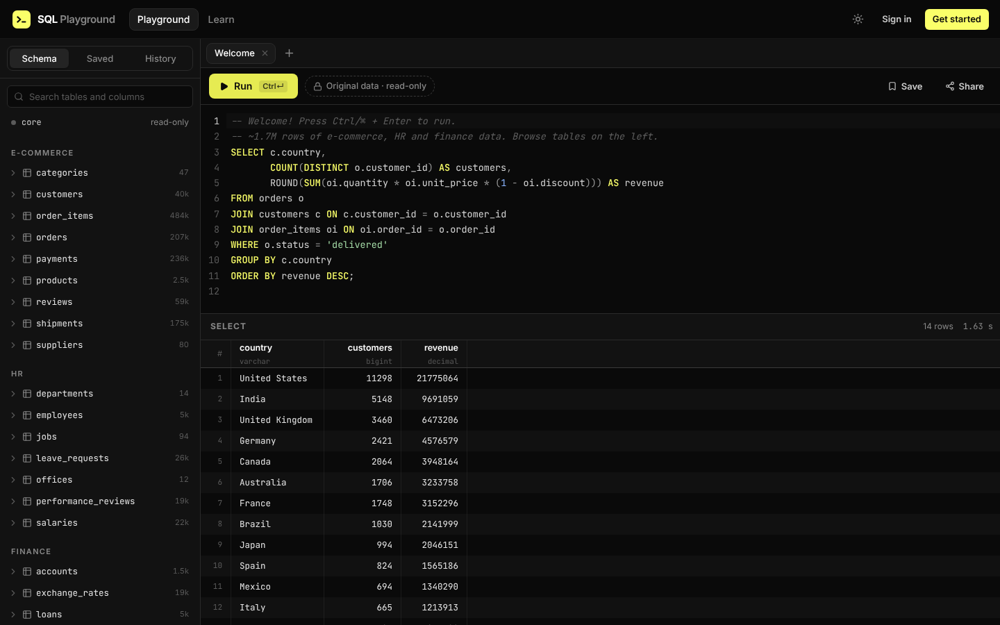
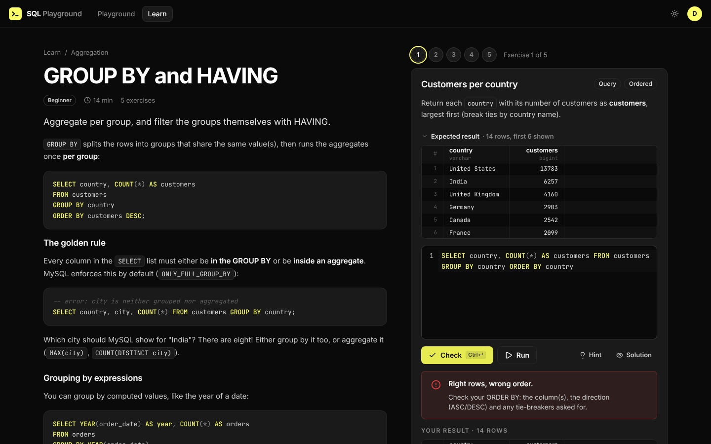
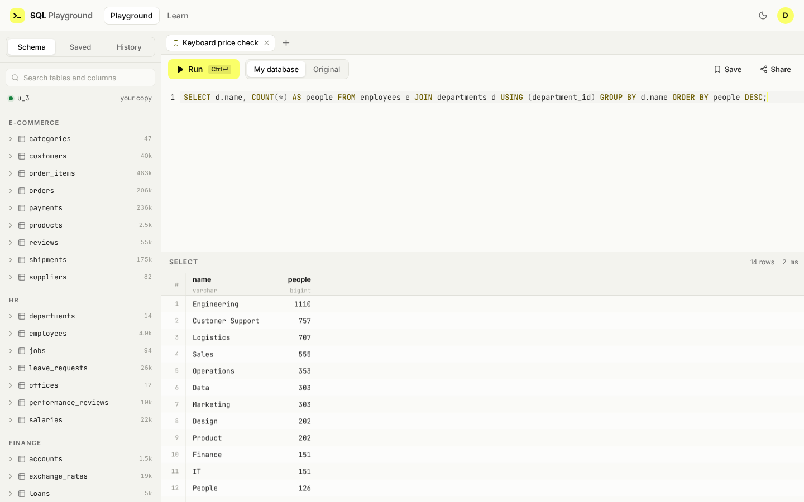

# SQL Playground

A self-hosted MySQL playground for learning SQL on realistic data, from your first `SELECT` to window functions, transactions and schema design.

- **Anyone** can open the playground and run read-only queries against ~1.7 million rows of e-commerce, HR and finance data.
- **Signed-in learners** get a **private copy of the whole database** where `INSERT`, `UPDATE`, `DELETE`, `CREATE`, triggers and stored procedures all work. Changes only affect their copy, and **Reset database** restores the original in about 10 seconds.
- **30 lessons with 116 auto-checked exercises** take you from basics to analytics case studies (cohorts, gaps-and-islands, RFM, drawdowns).

It's built for a small group (up to 20 accounts) on a single VPS. Behaviour matches real MySQL, because it *is* real MySQL 8.4.



| Lessons with instant feedback | Light theme |
|---|---|
|  |  |

## Features

**Playground**
- SQL editor (CodeMirror 6) with MySQL syntax, autocompletion from the live schema, multiple tabs, and run-selection with Ctrl/⌘+Enter
- Run several statements at once, including `DELIMITER //` blocks for procedures and triggers, as in the mysql command line
- Virtualized results grid, per-statement result tabs, warnings, and friendly hints for common errors (`ONLY_FULL_GROUP_BY`, foreign keys, error 1093, …)
- Schema browser with row counts, column types and key/foreign-key markers, plus one-click table preview
- **Sessions persist between runs**: `START TRANSACTION` in one run and `ROLLBACK` in the next, with a "Transaction open" indicator and one-click Commit/Rollback
- Cancel running queries; time limits (30s signed in, 15s anonymous); a 2,000-row display cap with true row counts
- Saved queries, searchable history and share links (`/q/<id>`)

**Learning**
- 30 lessons in 9 modules: Basics → Aggregation → Joins → Subqueries & CTEs → Window functions → Dates, text & JSON → Changing data → Designing databases → Analytics case studies
- Exercises are checked against the real database:
  - **query** exercises compare your result with the solution's (order-aware when it matters, with numeric tolerance)
  - **DML** exercises run inside a transaction that is rolled back
  - **DDL** exercises inspect the objects you created
- Expected-output preview, hints, solutions, and progress tracking (in the browser when signed out, carried over when you sign up)

**Design**
- The ClickHouse design system (near-black canvas, electric-yellow accent, Inter + JetBrains Mono), with dark as the default and a light theme
- Apple-style motion: critically damped springs, press feedback on pointer-down, popovers that grow from their trigger, a draggable bottom sheet on phones, rubber-banded resizable panes. Respects reduced motion, reduced transparency and increased contrast.

## The dataset

Generated deterministically (same data on every install), stored in one InnoDB tablespace of **148 MB**:

| Domain | Tables (rows) |
|---|---|
| E-commerce | `customers` (40k), `orders` (207k), `order_items` (484k), `payments` (236k), `shipments` (175k), `reviews` (59k), `products` (2.5k), `categories` (3-level tree), `suppliers` |
| HR | `employees` (5k, 5-level manager hierarchy), `salaries` (22k, full history), `performance_reviews` (19k), `leave_requests` (26k), `departments`, `jobs`, `offices` |
| Finance | `stock_prices` (140k daily OHLCV, 2018–2025), `transactions` (190k), `trades` (16k), `exchange_rates` (19k), `accounts`, `loans`, `stocks` |
| Utility | `calendar` (2012–2030) |

The data has realistic texture: growth over time, Black Friday and holiday peaks, churn, cohorts, returns that skew to fashion, salary raises and promotions, a COVID-style market crash, IPOs and delistings, paired transfers between accounts, and some deliberate messiness for cleaning exercises (inconsistent phone formats, stray spaces in city names, mixed-case emails, NULLs).

## Architecture

```
browser ──▶ nginx (TLS) ──▶ app container :8080 (127.0.0.1 only)
                              │  Go API + built React frontend
                              ▼
                            mysql:8.4 container (no published port)
                              ├─ core            pristine dataset, read-only to everyone
                              ├─ u_<id>          each learner's private copy (own tablespace)
                              └─ playground_app  accounts, sessions, saved queries, history, progress
```

- **Isolation is enforced by MySQL itself**, not by parsing SQL. Anonymous visitors use a `SELECT`-only account on `core`. Each learner gets their own MySQL account with full rights on their own schema and read-only access to `core`. They can't see other schemas, read files, change global settings or create users.
- **Copies** are made with `INSERT … SELECT` into a per-user general tablespace (about 10s). One file per user also makes storage easy to measure and to reclaim on reset.
- **Guards:** a watchdog runs `KILL QUERY` at the time limit or on Cancel; a quota monitor stops writes that push a database past its storage limit (300 MB by default); there are rate limits, a global concurrency limit, and `MAX_USER_CONNECTIONS` per account.
- MySQL passwords for these accounts are random, held in memory only, and rotated on every start.

More detail and the reasoning behind each choice: [docs/PLAN.md](docs/PLAN.md).

## Repository layout

```
backend/    Go API, dataset generator, lessons (Markdown) and exercise checker
frontend/   React + Vite + TypeScript app
deploy/     docker-compose.yml, MySQL config, nginx site config, .env.example
Dockerfile  builds frontend + backend into one small image
docs/       plan and screenshots
```

## Deploying on your VPS (Docker Compose + nginx + ufw)

This setup coexists with nginx and ufw already serving other projects: nothing new is exposed to the internet.

1. **Install Docker** (with the compose plugin) if it isn't installed yet: https://docs.docker.com/engine/install/

2. **Clone and configure**
   ```bash
   git clone https://github.com/darshan260802/sql-playground.git
   ```
   ```bash
   cd sql-playground/deploy && cp .env.example .env
   ```
   Edit `.env`: set a long random `MYSQL_ROOT_PASSWORD` (e.g. `openssl rand -base64 32`), and change `APP_PORT` if 8080 is already used on the host.

3. **Start it**
   ```bash
   docker compose up -d --build
   ```
   The first start generates the dataset (about 20–30s). Follow it with `docker compose logs -f app` until you see `listening on :8080`.

4. **nginx**: copy `deploy/nginx/sql-playground.conf` to `/etc/nginx/sites-available/`, replace `sql.example.com` with your domain (and the port if you changed `APP_PORT`), then:
   ```bash
   sudo ln -s /etc/nginx/sites-available/sql-playground.conf /etc/nginx/sites-enabled/
   ```
   ```bash
   sudo nginx -t && sudo systemctl reload nginx
   ```
   ```bash
   sudo certbot --nginx -d sql.example.com
   ```

5. **ufw**: nothing to open. The app is bound to `127.0.0.1` (Docker-published ports bypass ufw, so binding to loopback is what keeps ufw in charge), and MySQL isn't published at all. Your existing `Nginx Full` / `OpenSSH` rules are enough.

> Behind HTTPS keep `COOKIE_SECURE=true`. For a quick test over plain HTTP set it to `false`, otherwise the browser won't send the login cookie.

### Resources (measured)

- **Disk:** ~1.1 GB for MySQL's base files and the core data, plus **148 MB per learner**, up to the 300 MB quota. 20 learners need 3–6 GB in total.
- **RAM:** MySQL about 1.2 GB (2 GB buffer pool cap, `mem_limit` 3 GB); the app about 30 MB.
- To use less RAM, lower `innodb_buffer_pool_size` in `deploy/mysql/playground.cnf` (e.g. `1G`).

### Admin tasks

There is no email sending, so the admin resets forgotten passwords:

```bash
docker compose exec app /app/sqlpg admin list-users
```
```bash
docker compose exec app /app/sqlpg admin reset-password someone@example.com
```
```bash
docker compose exec app /app/sqlpg admin reset-db someone@example.com
```
```bash
docker compose exec app /app/sqlpg admin delete-user someone@example.com
```

**Updating:** `git pull && docker compose up -d --build` (from `deploy/`). Learner data lives in the `mysql-data` volume and survives rebuilds.

**Backups:** only `playground_app` holds data worth keeping (accounts, saved queries, progress); learner copies can always be recreated.
```bash
docker compose exec mysql sh -c 'MYSQL_PWD=$MYSQL_ROOT_PASSWORD mysqldump -uroot --single-transaction playground_app' > playground_app.sql
```

### Configuration

All settings are environment variables (set through `deploy/.env` / `docker-compose.yml`):

| Variable | Default | Meaning |
|---|---|---|
| `SQLPG_MAX_USERS` | 20 | signups close when this many accounts exist |
| `SQLPG_USER_QUOTA_MB` | 300 | storage limit per learner database |
| `SQLPG_QUERY_TIMEOUT` / `SQLPG_ANON_QUERY_TIMEOUT` | 30s / 15s | per-run time limit |
| `SQLPG_MAX_ROWS` | 2000 | rows sent to the browser per result |
| `SQLPG_MAX_CONCURRENT` | 8 | queries executing at once, server-wide |
| `SQLPG_SESSION_IDLE` | 15m | idle time before a learner's SQL session (and open transaction) is closed |
| `SQLPG_SESSION_DAYS` | 30 | login cookie lifetime |
| `SQLPG_COOKIE_SECURE` | true in compose | send cookies over HTTPS only |
| `SQLPG_TRUST_PROXY` | true in compose | take client IPs from nginx headers (for rate limits) |

## Local development

Requirements: Go 1.24+, Node 22+, and MySQL 8.0.31+ (8.4 recommended). A throwaway MySQL in Docker works:

```bash
docker run -d --name sqlpg-mysql -e MYSQL_ROOT_PASSWORD=dev -p 127.0.0.1:3306:3306 -v "$PWD/deploy/mysql/playground.cnf:/etc/mysql/conf.d/playground.cnf:ro" mysql:8.4
```

API on :8080 (generates the dataset on first start):

```bash
cd backend && SQLPG_MYSQL_ADMIN_PASSWORD=dev go run ./cmd/sqlpg serve
```

Frontend on :5173 with hot reload (proxies `/api` to :8080):

```bash
cd frontend && npm install && npm run dev
```

### Tests

```bash
cd backend && go test ./...
```

The lesson suite runs **every exercise against a real MySQL**. It checks that the solution passes its own check and that a wrong answer fails:

```bash
cd backend && SQLPG_TEST_DSN='root:dev@tcp(127.0.0.1:3306)/' go test ./internal/lessons/ -run TestSolutions -v
```

### Writing lessons

Lessons are Markdown files in `backend/internal/lessons/content/` (`NN-slug.md`) with a small header and `=== exercise` blocks (prompt, solution, hint, and for DML/DDL a `check` query and a `setup`). See the format notes at the top of `backend/internal/lessons/lessons.go`, then run the lesson test suite.
